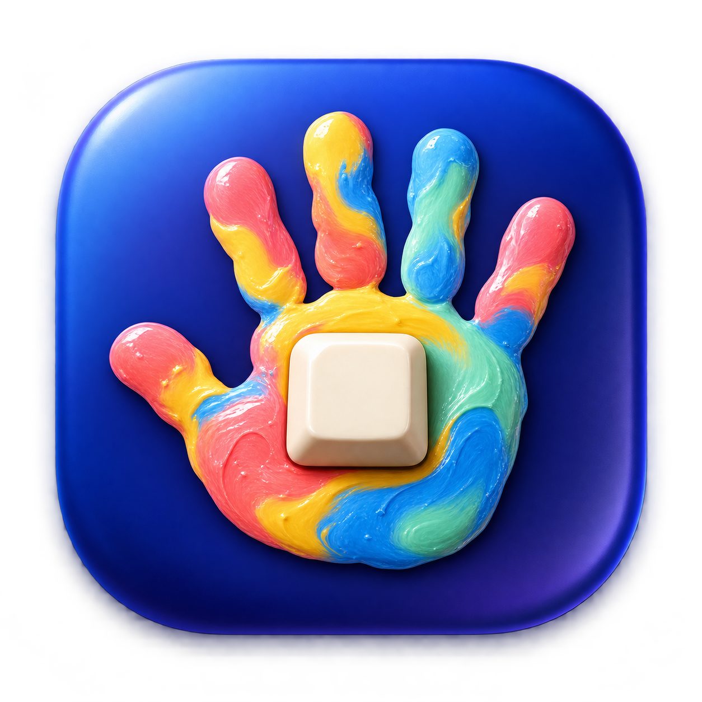

<p align="center">
  
</p>

<h1 align="center">KeySplash</h1>

<p align="center">A playful macOS keyboard lock for little hands and curious kids.</p>

KeySplash turns keyboard-cleaning mode into a tiny screen adventure. It temporarily blocks keyboard input while colorful, oversized handprints appear where the keys are pressed. The screen stays transparent, so your child can pretend to work while your apps are protected from accidental keystrokes.

## Install KeySplash

1. Download **KeySplash-macOS.zip** from the [latest release](https://github.com/beautyfree/keysplash/releases/latest).
2. Open the ZIP and drag **KeySplash.app** into your **Applications** folder.
3. Open KeySplash. On first launch, follow the on-screen Accessibility setup. Once access is enabled, KeySplash starts automatically.

KeySplash is a ready-to-run macOS app; you do not need Xcode or a separate installer. The release is signed and notarized by Apple.

## Why we made it

KeySplash began with a familiar parent problem: a little one reaches the computer and enthusiastically presses every key. The original Cleaning Mode solved the practical part by blocking keyboard input behind a quiet, dark screen. We liked how simple it was, but wanted the moment to feel like play instead of a forbidden computer.

So we kept the keyboard lock and made the display a canvas. Each key maps to its physical place on the screen; presses leave large, colorful handprints in varied sizes and angles. Repeated tapping adds a little extra flourish. The result is a child-friendly keyboard-cleaning mode that lets kids explore the keyboard while reducing accidental typing in whatever was open.

KeySplash is inspired by the Cleaning Mode in [Vorssaint’s vorssaint-utils](https://github.com/vorssaint/vorssaint-utils). The keyboard lock, Escape unlock gesture, and mouse-unlock behavior are adapted under GPL-3.0-or-later; the handprint play layer and KeySplash interface make it our own macOS app.

## Accessibility setup

macOS requires Accessibility access before an app can capture and block keyboard input system-wide. KeySplash explains this in a visual setup window and does not lock the keyboard until permission is available.

1. Click **Open Accessibility Settings** in KeySplash.
2. In **System Settings → Privacy & Security → Accessibility**, switch on **KeySplash**. If it is not listed, use **+** and choose KeySplash from Applications.
3. Return to KeySplash. It checks the permission and starts automatically. If macOS has not refreshed access yet, choose **Reopen KeySplash** in the setup window.

You can also click **Check Access** after enabling the switch. KeySplash keeps the setup window open while you visit System Settings, so there is no need to hunt for the app again.

## Play mode

- Covers every display with a transparent overlay; key positions are mapped across the full keyboard and screen.
- Supports ANSI, ISO, and JIS physical keyboard layouts.
- Shows randomized left- and right-hand prints with varied colors, sizes, and tilt.
- Adds a larger splash and sparkles when a key is pressed repeatedly.
- Plays short, gentle notes; use the speaker button to mute them.
- Unlocks when you click **Unlock** or press **Escape** five times.
- Keeps macOS Force Quit available as an emergency exit.

## Development

KeySplash is a native Swift app for macOS 14 or later. To build locally, install Xcode Command Line Tools and run:

```sh
./build-app.sh
open dist/KeySplash.app
```

The app bundle is assembled with its app icon and handprint artwork by `build-app.sh`. GitHub Actions builds it for pushes and pull requests. A `v*` tag publishes a GitHub Release after signing with a Developer ID certificate and notarizing the app with Apple. Repository Actions secrets required for release publishing:

- `DEVELOPER_ID_CERTIFICATE_P12_BASE64`
- `DEVELOPER_ID_CERTIFICATE_PASSWORD`
- `APP_STORE_CONNECT_API_KEY_BASE64`
- `APP_STORE_CONNECT_API_KEY_ID`
- `APP_STORE_CONNECT_ISSUER_ID`

See [LICENSE](LICENSE) for license terms.
